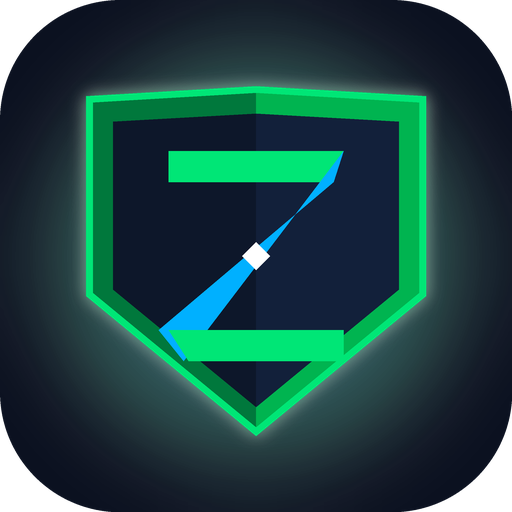

<p align="center">
  
  <h1 align="center">ZevBlock</h1>
  <p align="center"><strong>Hardened System-Level Adult Content Filter, Local DNS Sinkhole &amp; Anti-Bypass Accountability OS for Android</strong></p>
</p>

[](https://github.com/zevbuild/zevblock/actions/workflows/build.yml)
[](https://github.com/zevbuild/zevblock/releases/tag/v1.2-stable)
[](https://developer.android.com)
[](https://github.com/zevbuild/zevblock)
[](LICENSE)

ZevBlock is a hardened, battery-efficient Android protection and accountability platform designed to eliminate pornography and adult material at the **system and network level**, enforce strict SafeSearch across search engines, scrape browser address bars, prevent Private DNS/VPN tampering, and lock out self-bypass via Device Owner and offline cryptographic two-person rules.

---

## 📦 Download & Install APK

Pre-compiled APKs are built directly by automated GitHub CI:

### Option A: From GitHub Releases (Recommended)
1. Navigate to [**GitHub Releases**](https://github.com/zevbuild/zevblock/releases/tag/v1.2-stable).
2. Under the latest **v1.2-stable** release, download `ZevBlock-v1.0-debug.apk` or `ZevBlock-latest.apk`.
3. Open the downloaded file on your Android device to install.

### Option B: From GitHub Actions CI Artifacts
1. Go to the [**Actions**](https://github.com/zevbuild/zevblock/actions) tab.
2. Select the latest run of **"Build & Release ZevBlock APK"**.
3. Under the **Artifacts** section at the bottom, download `ZevBlock-v1.0-debug-apk.zip` containing the pre-compiled APK.

---

## 🛡️ Core Defensive Architecture

```
                             [ Network Layer ]
+--------------------------------------------------------------------------+
|  Tier 1: SafeSearch VIP Interception                                     |
|  -> Google (216.239.38.120), YouTube (216.239.38.119), Bing, DDG, Yahoo  |
|                                                                          |
|  Tier 2: In-Memory StevenBlack & Adult CDN Blocklist (150+ Top Seeds)     |
|  -> phncdn.com, ypncdn.com, xhcdn.com, pornhub, xvideos, cams, onlyfans  |
|                                                                          |
|  Tier 3: Upstream Cloudflare Family (1.1.1.3) & CleanBrowsing Fallback   |
|  -> Unlisted/new adult domains automatically sinkholed by upstream DNS   |
+--------------------------------------------------------------------------+
                                    |
                            [ Screen Layer ]
+--------------------------------------------------------------------------+
|  Accessibility URL & On-Screen Node Scraper                              |
|  -> 30+ Browsers (Chrome, Firefox, Brave, Kiwi, Via, Aloha, Opera, etc.)  |
|  -> Universal On-Screen Inspector (blocks adult content across any app)  |
|  -> NSFW Regex Classifier (word boundary matching, leetspeak, TLDs)      |
+--------------------------------------------------------------------------+
                                    |
                            [ Device Layer ]
+--------------------------------------------------------------------------+
|  DevicePolicyManager Anti-Bypass Lockdown                                |
|  -> DISALLOW_CONFIG_PRIVATE_DNS (prevents DoT bypass)                    |
|  -> DISALLOW_INSTALL_UNKNOWN_SOURCES (blocks sideloading adult apps)     |
|  -> Always-On VPN Lockdown (drops traffic if VPN stops)                  |
|  -> DISALLOW_SAFE_BOOT & Anti-Uninstall Block                            |
+--------------------------------------------------------------------------+
```

---

## 🔒 4 Defense Pillars in Detail

### 1. 3-Tier Local DNS Sinkhole (`DnsBlockerVpnService`)
* **Battery-Optimized Virtual Split Routing:** Allocates virtual IP `10.254.1.1/32` (and IPv6 `fd00::1/128`) and routes **only port 53 DNS queries** through the TUN interface. Standard TCP/UDP data traffic (browsing, streaming, downloads, gaming) continues at full wire speed without VPN latency or thermal throttling.
* **Adult Content Delivery Network (CDN) Sinks:** Hierarchically blocks adult video CDNs (`phncdn.com`, `ypncdn.com`, `xhcdn.com`, `rncdn3.com`, `bcvcdn.com`, etc.), which completely breaks streaming video playback on mobile devices even if embedded within third-party viewers or WebViews.
* **Strict SafeSearch VIP Rewriting:** Intercepts DNS queries targeting search engines and forces them to strict VIPs:
  * **Google:** `216.239.38.120` (`forcesafesearch.google.com`)
  * **YouTube:** `216.239.38.119` (Strict Restricted Mode VIP)
  * **Bing:** `204.79.197.220` (`strict.bing.com`)
  * **DuckDuckGo:** `safe.duckduckgo.com`
  * **Yahoo:** `safe.search.yahoo.com`
  * **Brave Search:** `safe.brave.com`
  * **Qwant:** `safe.qwant.com`
* **In-Memory StevenBlack & Adult Database:** 150+ top global adult tube sites, webcam networks, escort aggregators, hentai/anime portals, and fan leak platforms with $O(\text{labels})$ hierarchical suffix matching.
* **Adult-Filtering Upstream Resolvers:** Forwards clean queries to **Cloudflare Family** (`1.1.1.3` / `1.0.0.3`) and **CleanBrowsing Adult Filter** (`185.228.168.10`) via non-blocking asynchronous coroutines. Any unlisted adult domain is automatically sinkholed by upstream DNS.
* **Automatic Boot Recovery:** Automatically restarts the DNS sinkhole upon system boot via `BootCompletedReceiver`.

### 2. Universal Accessibility & On-Screen Guard (`ShieldAccessibilityService`)
* **30+ Supported Mobile Browsers:** Extracts address bar URLs across Chrome, Firefox, Brave, Edge, Samsung Internet, Opera (GX, Touch, Mini), Kiwi, Via, Aloha, Vivaldi, Puffin, Tor Browser, Mint, Phoenix, UC Browser, and generic WebViews.
* **Universal Screen Content Inspector:** Monitors on-screen window hierarchies across **any app** (including social apps, Reddit, and unlisted WebViews) for explicit adult titles or keywords, executing `GLOBAL_ACTION_BACK` and displaying a warning overlay.
* **Incognito & Private Window Blocker:** Detects Incognito mode triggers and immediately closes the window.
* **Intelligent NSFW Classifier (`NsfwContentDetector`):**
  * Multilingual explicit terms (English, Spanish, Portuguese, French, German).
  * Explicit URL path segment triggers (`/porn/`, `/xxx/`, `/hentai/`, `/nsfw/`, `/adult/`, `/cams/`, `/webcam/`).
  * Explicit TLD filters (`.xxx`, `.adult`, `.porn`, `.sex`, `.sexy`, `.cam`, `.tube`).
  * Comprehensive query parameter extractor (`?q=`, `&search_query=`, `?search=`, `?keyword=`, `?term=`, `?p=`, `?w=`).
  * Word-boundary regex matching (`(^|[^a-z0-9])keyword([^a-z0-9]|$)`) on short terms to prevent false positives on harmless words ("essex", "sussex", "analysis", "canal", "documentary").
* **Settings Anti-Tamper Guard (`SettingsTamperGuard`):** Inspects `com.android.settings` to prevent unauthorized navigation into:
  * App Info (blocks "Force stop", "Uninstall", "Clear data")
  * Accessibility Service toggles (prevents turning off protection)
  * Device Administrator settings (prevents deactivation)
  * VPN and Private DNS configuration screens

### 3. Device Owner Anti-Bypass Lockdown (`DeviceAdminManager`)
* **OS-Level Uninstall Block:** Calls `DevicePolicyManager.setUninstallBlocked()` to disable uninstallation at the operating system level.
* **Safe Mode Boot Prevention:** Enforces `UserManager.DISALLOW_SAFE_BOOT` so restrictions cannot be bypassed by booting into Android Safe Mode.
* **Private DNS Lock:** Enforces `UserManager.DISALLOW_CONFIG_PRIVATE_DNS` to prevent bypassing local DNS sinkholes via Android 9+ DNS-over-TLS (DoT).
* **Unknown Sources Sideload Block:** Enforces `UserManager.DISALLOW_INSTALL_UNKNOWN_SOURCES` to block sideloading unauthorized adult APKs or proxy browsers.
* **Always-On VPN Lockdown:** Enforces `setAlwaysOnVpnPackage(adminComponent, packageName, lockdown = true)` to drop all device network traffic if the VPN service is ever disconnected.

### 4. Accountability Partner & Monotonic Cooldown Lock (`TamperLockManager`)
* **Offline RFC 6238 TOTP Engine:** Generates a 160-bit cryptographically secure Base32 secret and `otpauth://totp/...` URI scannable by Google Authenticator, Aegis, Bitwarden, or 2FAS on an accountability partner's phone.
* **Hardware Monotonic Clock Timer:** Employs `SystemClock.elapsedRealtime()` (hardware clock running since device boot, including deep sleep). Changing device date/time, advancing the system clock, or shifting timezones cannot accelerate countdown delays.
* **HMAC-SHA256 Integrity Sealing:** Cryptographically seals lock state with a 256-bit device key to detect and invalidate manual storage tampering.

---

## 📱 User Interface & Features

* **Dashboard Screen:** Hero defense status card with dynamic pulsing animation, 2x2 module status grid, live query counters, and real-time security activity feed.
* **Android 13+ "Restricted Settings" Bypass Visual Guide:** Illustrated step-by-step walkthrough resolving Android 13/14/15 sideloaded accessibility restrictions with direct intent launchers.
* **Partner Setup Screen:** Pure-Kotlin QR code view, copyable Base32 secret key, and rolling 6-digit code verifier with $\pm 30\text{s}$ drift tolerance.
* **Interactive Tools & Simulators:** Test DNS lookups against SafeSearch VIPs and adult blocklists, evaluate search query URLs, and preview the translucent warning overlay.

---

## 🚀 Setup & Provisioning Guide

### 1. Activating Device Owner (ADB)
To unlock hardware-level anti-uninstall protection and Safe Mode blocking, provision ZevBlock as the Device Owner via ADB:

```bash
# 1. Enable USB Debugging in Developer Options
# 2. Connect phone via USB
adb devices

# 3. Provision ZevBlock as Device Owner
adb shell dpm set-device-owner com.example/.receiver.ShieldDeviceAdminReceiver
```

> [!NOTE]
> Android requires that personal accounts (Google, etc.) are temporarily removed before provisioning Device Owner on an active device, or provisioned during initial device factory setup.

### 2. Activating via Shizuku / Root
If your device is rooted or has Shizuku configured:
```bash
dpm set-device-owner com.example/.receiver.ShieldDeviceAdminReceiver
```

### 3. Bypassing Android 13+ "Restricted Settings" for Sideloaded APKs
On Android 13, 14, and 15, accessibility services on sideloaded APKs are restricted by default:
1. Open **Settings > Apps > See all apps > ZevBlock** (or tap **"1. Open App Info"** in the ZevBlock setup tab).
2. Tap the **three vertical dots (⋮)** in the top right corner.
3. Tap **"Allow restricted settings"** and authenticate with your device PIN or fingerprint.
4. Return to ZevBlock and tap **"2. Open Accessibility"** to toggle on the service.

---

## 🧪 Testing & Automated Verification

The repository contains an automated test suite verifying core protocols:

```bash
# Run all unit tests locally
./gradlew :app:testDebugUnitTest --stacktrace
```

Tested components in [`ZevBlockCoreTest.kt`](app/src/test/java/com/example/ZevBlockCoreTest.kt) include:
* Adult search query parameter extraction across Google, YouTube, Bing, Yahoo, and DuckDuckGo
* Adult TLD (`.xxx`, `.adult`) and explicit path segment detection (`/porn/`, `/hentai/`)
* False-positive prevention for safe words ("essex", "sussex", "analysis", "canal", "documentary")
* Hierarchical subdomain blocking on adult CDNs (`video.edge.phncdn.com`, `m.xvideos.com`)
* SafeSearch VIP rewriting for Google, YouTube, Bing, and DuckDuckGo
* Raw RFC 1035 packet parsing, response synthesis, and IP/UDP checksum calculations
* Base32 encoding / decoding round-trip fidelity

---

## 🏗️ Project Directory Structure

```
zevblock/
├── app/src/
│   ├── main/
│   │   ├── AndroidManifest.xml                        # Service, receiver, and permission declarations
│   │   ├── java/com/example/
│   │   │   ├── MainActivity.kt                        # Primary Material 3 App Shell & Navigation
│   │   │   ├── core/
│   │   │   │   ├── admin/
│   │   │   │   │   └── DeviceAdminManager.kt          # DevicePolicyManager anti-bypass enforcer
│   │   │   │   ├── dns/
│   │   │   │   │   ├── DnsPacket.kt                   # Binary IP/UDP and DNS data models
│   │   │   │   │   ├── DnsPacketParser.kt             # Raw IPv4/IPv6 and RFC 1035 packet parser
│   │   │   │   │   ├── DnsPacketBuilder.kt            # Synthesizer for A/AAAA/CNAME records & checksums
│   │   │   │   │   ├── SafeSearchManager.kt           # Google / YouTube / Bing / DDG / Yahoo VIP rewriter
│   │   │   │   │   └── DomainBlocklistMatcher.kt      # StevenBlack & Adult CDN in-memory matcher
│   │   │   │   ├── accessibility/
│   │   │   │   │   ├── BrowserUrlExtractor.kt         # Address bar scraper (30+ browsers)
│   │   │   │   │   ├── NsfwContentDetector.kt         # Adult terms, leetspeak, TLDs & query detector
│   │   │   │   │   └── SettingsTamperGuard.kt         # com.android.settings inspection & blocker
│   │   │   │   └── security/
│   │   │   │       └── TamperLockManager.kt           # RFC 6238 TOTP engine & monotonic cooldown
│   │   │   ├── receiver/
│   │   │   │   ├── ShieldDeviceAdminReceiver.kt       # Device Administrator lifecycle receiver
│   │   │   │   └── BootCompletedReceiver.kt           # Boot completed auto-start receiver
│   │   │   ├── vpn/
│   │   │   │   ├── DnsBlockerVpnService.kt            # Local TUN DNS sinkhole & Cloudflare Family
│   │   │   │   └── ShieldVpnService.kt                # Service alias
│   │   │   ├── accessibility/
│   │   │   │   └── ShieldAccessibilityService.kt      # Universal screen & browser scraper service
│   │   │   └── ui/
│   │   │       ├── overlay/
│   │   │       │   ├── SecurityWarningOverlayActivity.kt # Translucent Compose warning overlay
│   │   │       │   └── OverlayManager.kt              # Debounced overlay trigger
│   │   │       ├── qr/
│   │   │       │   └── QrCodeGenerator.kt             # Pure-Kotlin QR matrix generator & Canvas view
│   │   │       ├── screens/
│   │   │       │   ├── DashboardScreen.kt             # Hero defense status & live telemetry
│   │   │       │   ├── OnboardingScreen.kt            # Restricted Settings bypass & permissions guide
│   │   │       │   └── PartnerSetupScreen.kt          # Friend QR code pairing & cooldown timer
│   │   │       └── theme/
│   │   │           ├── Color.kt                       # ZevBlock security palette
│   │   │           ├── Theme.kt                       # Material Design 3 Dark Theme
│   │   │           └── Type.kt
│   │   └── res/
│   │       ├── xml/
│   │       │   ├── accessibility_service_config.xml   # Accessibility window configuration
│   │       │   └── device_admin_rules.xml             # Device administrator policy declarations
│   │       └── values/
│   │           └── strings.xml                        # Localized labels and string resources
│   └── test/java/com/example/
│       └── ZevBlockCoreTest.kt                        # Core unit test suite
├── .github/workflows/
│   └── build.yml                                      # Automated CI build & release workflow
├── build.gradle.kts                                   # Root build script
├── settings.gradle.kts                                # Gradle settings
└── README.md                                          # Documentation
```

---

## 🔒 Security, Safety & Privacy Guarantee

* **100% On-Device Processing:** All domain matching, SafeSearch rewriting, and URL keyword scraping occur entirely in local device memory (RAM).
* **Zero Cloud Leakage:** No browsing logs, visited domains, search queries, or analytics are ever transmitted to remote servers.
* **Zero Invasive Permissions:** ZevBlock does **not** request contacts, SMS, call logs, location, camera, or microphone permissions.
* **Open-Source & Auditable:** Transparent Kotlin codebase with zero proprietary binary blobs or tracking SDKs.

---

## 📄 License

This project is open-source under the Apache 2.0 / MIT License.
